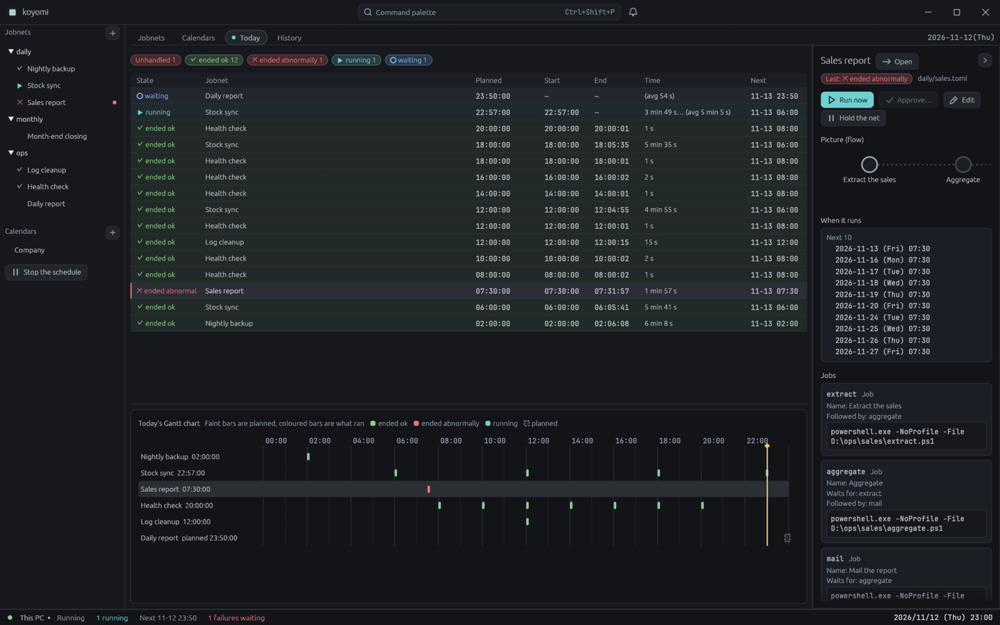
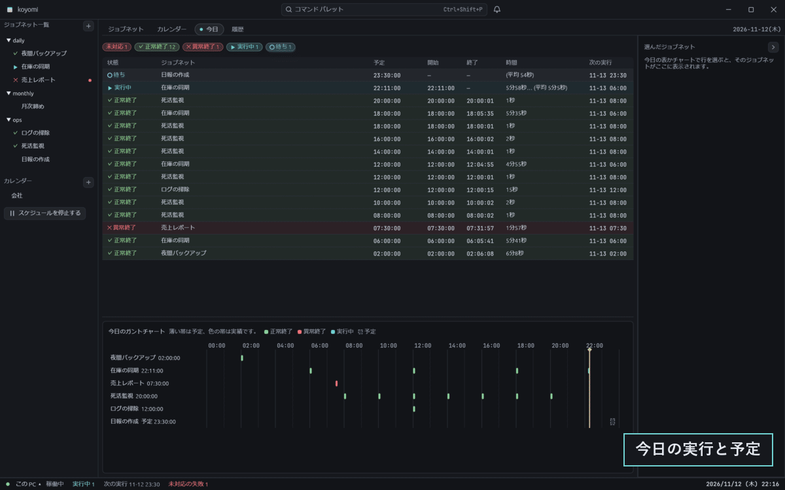
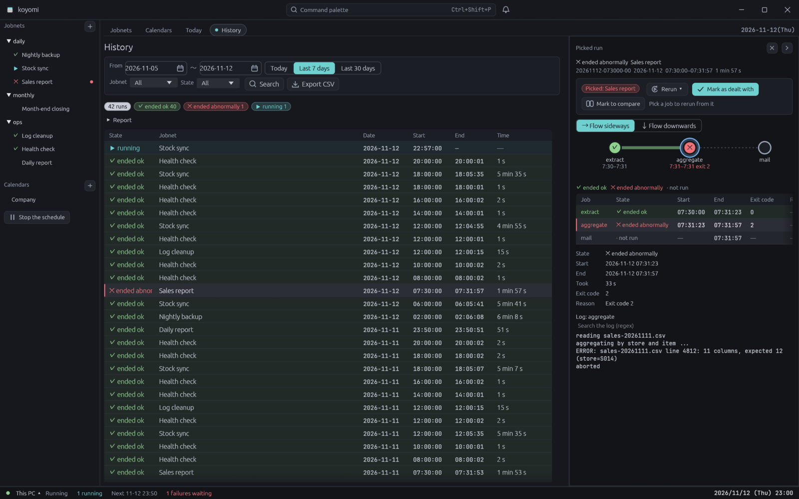

# koyomi

Small job scheduler and monitor (a light JP1)

One of the uchmk apps. Its shared parts come from [ito](https://github.com/uchmk/ito).

When koyomi shows an error or a warning, search [こんな時はどうする](docs/troubleshooting.md)
(what to do when…, in Japanese) for the ID at the start of the message, such as `KOYOMI-E2101`.

    cargo run

## What it looks like

How the images were taken is in [docs/images/README.md](docs/images/README.md) (in Japanese).

## Running the engine on Debian

The engine can run on Debian 12 or later as a systemd service, and the window on Windows
connects to it over HTTPS.

1. From [Releases](https://github.com/uchmk/koyomi/releases), put `koyomi_<version>_amd64.deb`
   (or `koyomi-<version>-linux-x86_64.tar.gz`) on the Debian machine.
2. Run `sudo apt install ./koyomi_<version>_amd64.deb` (for the tar.gz, unpack it and run
   `sudo ./install.sh`). At the end it prints the URL to connect to, the certificate's
   fingerprint and how to load the token.
3. In the window on Windows, click the connection in the status bar, then
   **Manage connections...** and **Add a connection...**, and enter the URL and the token.

Each user is given a role (`view`, `run`, `edit` or `admin`) that decides what they can do.
The user names exist only inside koyomi; they have nothing to do with the Linux users.

The full steps (users and roles, where the files are, updating, removing, and the limits)
are in [koyomi エンジンを Debian にインストールする](packaging/linux/README.md)
(installing the koyomi engine on Debian, in Japanese).
